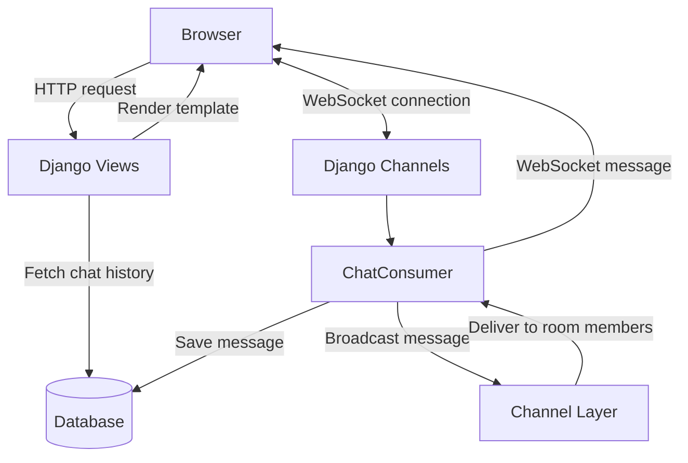

# Real-Time Chat Application

A real-time chat application built with Django and Django Channels.

## Features

- **Chat rooms:** Separate conversations organized by room.
- **Real-time messaging:** Messages are broadcast to connected users using WebSockets.
- **Message persistence:** Messages are stored in the database using Django ORM.
- **Chat history:** Previously saved messages are displayed when a room is opened.
- **Responsive UI:** Dark-themed interface that adapts to mobile and desktop screens.

## Tech Stack

- **Backend:** Python, Django
- **Real-time communication:** Django Channels, WebSockets
- **ASGI server:** Daphne
- **Database:** Django-supported database
- **Frontend:** HTML, CSS, JavaScript
- **Version control:** Git and GitHub

## Architecture

The application uses Django for HTTP requests and database operations, while Django Channels manages persistent WebSocket connections.



## Project Structure

```text
Real-time-chat-app/
├── config/
│   ├── settings.py
│   ├── urls.py
│   └── asgi.py
├── chatrooms/
│   ├── migrations/
│   ├── templates/
│   │   └── chatrooms/
│   │       ├── index.html
│   │       └── chats.html
│   ├── models.py
│   ├── views.py
│   ├── urls.py
│   ├── consumers.py
│   └── routing.py
├── manage.py
├── requirements.txt
└── README.md
```

## Installation and Setup

### 1. Clone the repository

```bash
git clone https://github.com/nishanth964/Real-time-chat-app.git
cd Real-time-chat-app
```

### 2. Create and activate a virtual environment

On macOS or Linux:

```bash
python3 -m venv .venv
source .venv/bin/activate
```

### 3. Install dependencies

```bash
pip install -r requirements.txt
```

### 4. Apply database migrations

```bash
python manage.py migrate
```

### 5. Create chat rooms

```bash
python manage.py createsuperuser
```

Start the server, log into the Django admin, and create chat rooms with unique slugs.

### 6. Run the application

```bash
python manage.py runserver
```

Open the application at:

`http://127.0.0.1:8000/rooms/`

